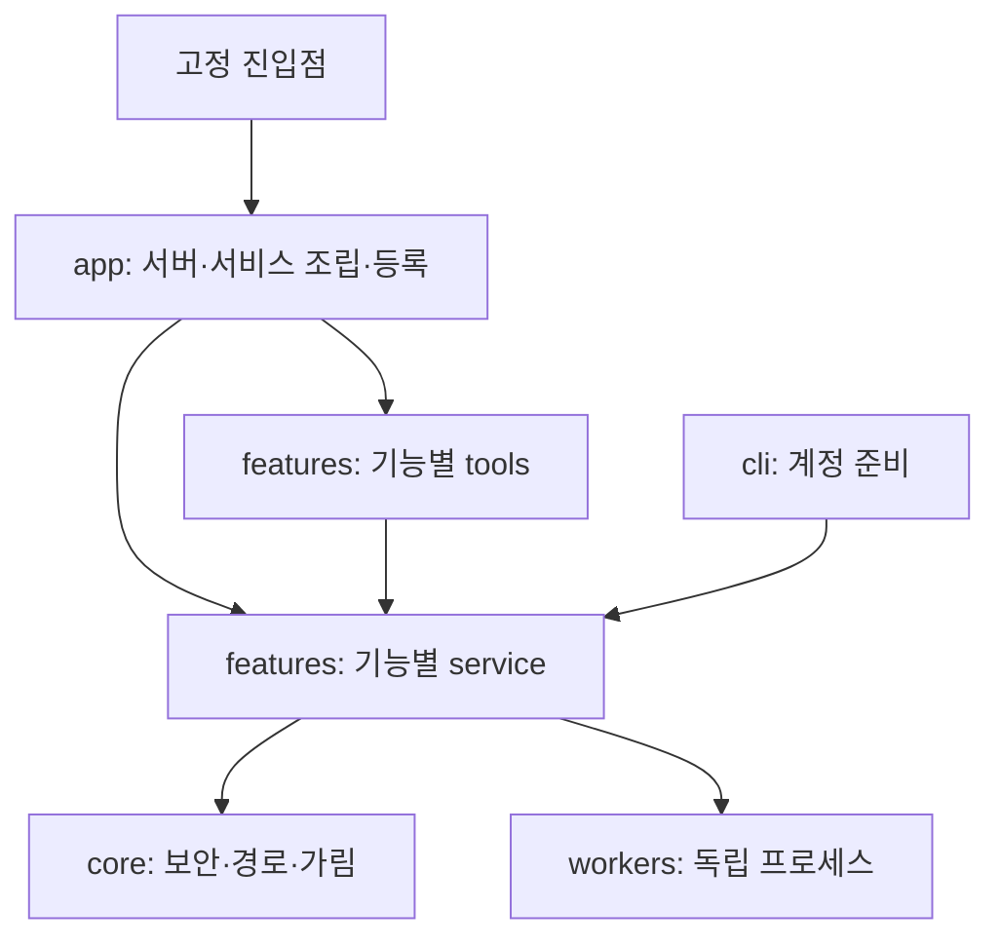

# 기능별 패키지 구조와 이전 계획

2026-10-20 확장: `features/integrations/service.py`와 개별 tools/에 REA 정적 분석·Agent Reach RSS를 묶었다. `app/runtime.py`에서 기존 WebCollector와 같은 guard를 주입하고, 공개 네트워크 검증은 web 서비스가 담당한다. 별도 `workers/agent_reach_feed.py`는 바이트 입력만 오프라인 처리하며 프로젝트 모듈을 임포트하지 않는다. 신뢰된 실행 경로는 config/integrations.json, 외부 설치물은 Git 제외 .integrations/에 두고 데이터 작업공간 밖을 유지한다. 기존 27개 계약에 2개만 추가했다.

[문서 안내](README.md) · [현재 계획](PLAN.md)

2026-10-18 사용자 요청에 따른 구조 정비 계획입니다. 기존 도구를 유지하면서 아래 순서대로 적용하고 완료 상태를 검증 후 기록합니다. 새로운 비서 기능이나 Phase 2.5 실행을 추가하는 작업은 아닙니다.

## 해결할 문제와 선택

루트에 서비스·보안·서버 조립·네트워크 작업자·인증 도우미가 함께 놓여 있습니다. 현재 파일 위치에 의존한 경로 계산은 이동 때 인증/설정을 놓칠 수 있고, 웹 기능의 비밀값 가림이 개발 진단 모듈에 의존해 불필요한 결합도 있습니다.

모든 실행 코드를 `jarvis/` 패키지로 모으고 **기능별 서비스와 MCP 도구를 같은 폴더**에 둡니다. 외부 모델이나 패키지 설치 단계 없이 현재 가상환경과 stdio 실행을 유지합니다. 단순히 모든 파일을 한 폴더로 옮기거나 옛 파일마다 호환 사본을 남기지 않습니다.

## 목표 디렉터리

```text
project/
├── server.py                       # 기존 Codex/Claude용 고정 진입점
├── google_auth_setup.py            # 기존 OAuth 명령용 고정 진입점
├── jarvis/
│   ├── __main__.py                 # python -m jarvis
│   ├── core/
│   │   ├── guardrails.py           # 기존 보안·예산·중단 정책
│   │   ├── paths.py                # 프로젝트/설정/인증/작업자 경로의 단일 기준
│   │   └── redaction.py            # 공통 비밀값 가림
│   ├── app/
│   │   ├── server.py               # FastMCP 생성·시작
│   │   ├── runtime.py              # 서비스 조립·공통 호출 경계
│   │   └── plugins.py              # features/<기능>/tools/*_tool.py 자동 등록
│   ├── features/
│   │   ├── system/tools/           # 기존 시스템 도구 3개
│   │   ├── knowledge/{service.py,tools/}
│   │   ├── google/{service.py,tools/}
│   │   ├── snapshots/{service.py,tools/}
│   │   ├── files/{service.py,tools/}
│   │   ├── workflows/{service.py,tools/}
│   │   ├── development/{service.py,tools/}
│   │   └── web/{service.py,tools/}
│   ├── workers/
│   │   ├── web_https.py            # -I로 직접 실행 가능한 독립 HTTPS 작업자
│   │   └── workflow_status.py      # 파일 미제공 상태 서버
│   └── cli/google_auth.py          # OAuth 운영자 명령 구현
├── config/                         # 신뢰된 운영자 설정, 기존 위치 유지
├── tests/                          # 기존 회귀 검사 + 구조/경로/전체 계약 검사
├── scripts/                        # 문서·구조 검증 등 개발 명령만
├── docs/                           # 현재 계획·사용 안내·단계 보고·역사 자료
├── JarvisWorkspace/                # 사용자 데이터, 기존 위치 유지
├── .jarvis-auth/                    # 인증정보, 기존 위치 유지
└── sources/                        # 동기화 원본, 읽기 전용
```

각 폴더의 `__init__.py`는 패키지 표시만 담당하며 서비스 자동 실행/네트워크 부작용을 넣지 않습니다. 빈 미래 폴더를 미리 만들지 않습니다. 파일당 MCP 도구 1개와 기존 27개 도구 계약을 유지합니다. 아래 Phase 2.5 확장처럼 실제 구현 범위가 생길 때 새 책임별 패키지를 추가합니다.

## 의존 방향과 확장 규칙



- core는 app/features/cli를 역참조하지 않습니다. workers는 직접 실행할 수 있도록 프로젝트 패키지에 의존하지 않습니다.
- 기능 서비스가 app/cli나 다른 기능의 도구 어댑터를 import하지 않습니다. 현재 파일 정리·진단·웹의 스냅샷 안전 읽기 공유는 명시적인 기존 서비스 의존으로 유지합니다.
- 새 도구는 해당 기능의 tools/에 추가합니다. 새 공통 보안 기능은 core/, 새 독립 프로세스는 workers/, 운영자 명령은 cli/에 둡니다. 새 서비스가 필요할 때 app/runtime.py의 조립만 확장합니다.
- 기능 폴더의 service.py는 자동 로더가 import하는 플러그인이 아닙니다. 자동 로더는 검증된 tools/*_tool.py만 등록하며 링크/정션/하드링크·중복 이름·잘못된 factory를 거부합니다.
- 루트 Python은 고정 진입점 2개만 허용하는 구조 검사기를 추가합니다. AST 기반 import 검사로 역방향 의존·이전 루트 모듈 재도입도 차단합니다. 동적 import까지 완전히 통제하는 샌드박스는 아닙니다.

## 이전 순서와 완료 조건

1. 이전 전 27개 MCP 이름·입력 스키마·설명 전체를 계약 파일로 보관하고 실행 코드/설정/문서만 로컬 백업합니다. sources·가상환경·사용자 데이터·비밀정보는 백업에 넣지 않습니다.
2. 패키지와 중앙 경로 기준을 만들고 코어·서비스·도구·작업자·CLI를 이동합니다. 내부 import와 자동 등록 경로를 함께 변경합니다.
3. 루트 server.py·google_auth_setup.py는 얇은 호환 진입점으로 유지합니다. Codex/Claude 등록 경로, 설정·인증·작업공간·중단 파일 경로는 그대로 유지합니다.
4. 구조·전체 27개 계약·기존 전체 회귀 검사·임의 cwd stdio 실행·패키지 실행·작업자 실행을 검증합니다. OAuth 로그인·실제 사용자 파일 변경·외부 API 호출은 불필요하게 반복하지 않습니다.
5. 지도와 안내·보고서를 실제 결과로 갱신하고 문서/구조 검사까지 통과시킵니다. 실패하면 이전 파일 백업과 원래 진입점으로 복원할 수 있게 합니다. 백업을 자동 복원하거나 정상 데이터를 덮어쓰지 않습니다.

이번 구조 정비는 모듈 import가 광범위하게 바뀌므로 사용자 Fast-Pass 규칙의 전체 검사 확대 조건에 해당합니다. 이동 자체보다 **기존 계약·경로·보안 경계 보존**을 완료 기준으로 삼습니다.

## 적용 결과 (2026-10-18)

계획 1~5를 완료했습니다. 루트의 실행 파일 2개를 유지하고 실제 구현은 위 패키지로 이전했습니다. 모든 27개 도구의 이름·스키마·설명 등 이전 전 전체 계약을 보존했습니다. 설정·인증·작업공간과 Codex/Claude 명령 경로도 그대로입니다.

최종 전체 검사 `212 passed in 15.58s`, 건너뜀 0개입니다. 임의 cwd의 기존 stdio 명령, python -m jarvis, OAuth 도움말(인증 실행 없음), 두 독립 작업자, 공통 보안·저장·검색·도구 동작을 확인했습니다. scripts/check_architecture.py와 scripts/check_docs.py도 통과했습니다. 전체 import 이동이므로 서버를 재연결해 새 코드를 불러와야 합니다. 이 결과는 Claude UI에서 재연결됐음을 의미하지 않습니다.

이전 전 85개 코드/설정/문서 파일은 artifacts/refactor/before-feature-layout.zip에 보관했습니다. 이 백업에는 .jarvis-auth, JarvisWorkspace, sources, .venv가 없음을 확인했습니다. 새 도구·모델·비서 기능은 이번에 추가하지 않았습니다. 상세 검증 이력은 [Phase 2 보고서](reports/phase-02.md)를 따릅니다.

## Phase 2.5 첫 확장 (2026-10-18)

jarvis/agents/models.py와 store.py를 추가해 영속 작업 상태·역할 순서·수정 상한을 분리했습니다. agents는 core와 자신의 모델에만 의존하고 app/cli/features/workers를 import하지 않습니다. core도 agents를 역참조하지 않습니다. 기존 서비스 조립·MCP 등록·진입점은 변경하지 않았습니다. 데이터는 작업공간 .jarvis-agents/에 저장하며 실행 코드·인증정보와 분리합니다. 실제 모델 호출과 실행기는 후속 계층으로 설계합니다. 사용 범위는 [작업 제어 안내](guides/agent-tasks.md)를 따릅니다.

명시적 파일 적용은 agents 제어 계층에 기능 의존성을 추가하지 않고 기존 development/service.py의 ProposalApplier에 둡니다. cli/agents.py가 작업 저장소와 스냅샷 서비스를 조립합니다. 순서는 CLI → development/snapshots 서비스와 agents이며 agents → 기능 서비스 역참조는 추가하지 않습니다. 기존 MCP 등록/조립은 변경하지 않았습니다.

## Phase 2.5 공유 제어 확장 (2026-10-18)

agents/에 memory.py(범위/확인/만료), events.py(영속 이벤트 계약과 비동기 pull), sandbox.py(고정 로컬 컨테이너 실행)를 추가했습니다. store.py는 상태·이벤트를 한 트랜잭션에 저장하고 예약/재개/보존을 통제합니다. app/events.py와 cli/events.py는 토큰/Origin/작업 범위를 검사하는 읽기 전용 loopback 전송이며 기본 MCP stdio 서버와 분리했습니다. cli/memory.py는 운영자 기억 관리입니다. 이미지/실행 파일은 코드 영역 config/agent_runtime.json에 고정하고 호스트 데이터를 컨테이너에 mount하지 않습니다. 전체 344개 통과 기록과 범위는 Phase 2.5 보고서, 운영은 guides/agent-controls.md를 따릅니다.
# 로컬 작업 HUD 경계 (2026-10-18 추가)

2026-10-20 확장: app/chat.py가 대화/도구 실행을 조립하고 agents/chat.py는 core에만 의존하는 대화 저장소를 담당한다. workers/chat_step.py는 고정 로컬 추론만 수행하며 도구는 실행하지 않는다. app/events.py의 선택적 인증 채팅 API는 제한된 모델·읽기 도구를 허용하고 기존 작업 조회/이벤트는 읽기 전용을 유지한다. MCP 도구 등록 수와 stdio 계약에는 채팅 도구를 추가하지 않는다. frontend/chat.js는 일반 텍스트 렌더링·대화 선택·전송을 담당한다. 사용 경계는 [채팅 안내](guides/chat.md)를 따른다.

`frontend/`는 buildless 정적 자산이며 `jarvis/app/events.py`가 정해진 세 경로와 인증된 상태 조회/이벤트만 제공한다. `jarvis/cli/hud.py`는 로컬 운영자가 시작하는 별도 진입점이다. 최근 작업 조회는 `agents/store.py`에 두고 브라우저 파일 선택은 인증 파일을 메모리에서만 사용한다. frontend에서 MCP stdio나 셸/모델 실행 경로를 추가하지 않는다. 루트 Python 실행 파일과 27개 MCP 계약은 유지한다. 실행·제한은 [HUD 안내](guides/local-hud.md)를 따른다.


2026-10-20 검색 확장: web/service.py의 SearchRequest와 search() 및 tools/search_public_web_tool.py를 추가했다. 기존 WebCollector._fetch와 web_https.py의 공개 IP/검증 IP 고정/리디렉션 거부를 재사용하며 고정 Bing RSS만 조회한다. 결과 URL은 자동 접속하지 않는 데이터다. app/chat.py는 예산을 예약한 로컬 검색어 변환과 서버 발췌 응답을 담당한다. 기존29개에1개 추가, 총30개이며 기존27개 계약은 유지한다.

검색 페이지 확인 확장: web/tools/read_public_web_page_tool.py는 WebCollector.read_page로 위임한다. MCP는 명시적 공개 HTTPS URL을, 채팅은 현재 요청의 성공 검색 결과 URL만 허용한다. 기존 pinned HTTPS worker와 공통 도구 예산을 재사용하며 정적 텍스트3000자만 반환한다. 총31도구/기존27계약보존.
